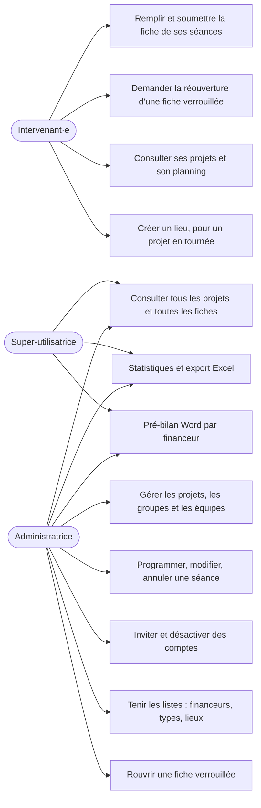
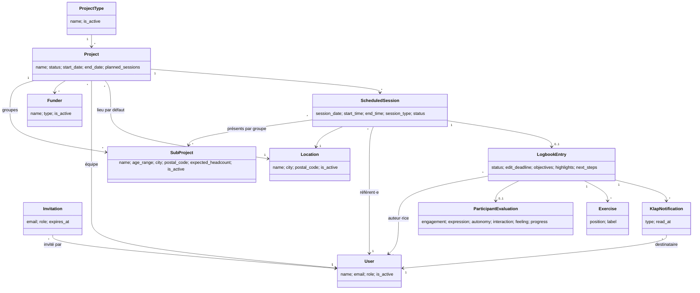
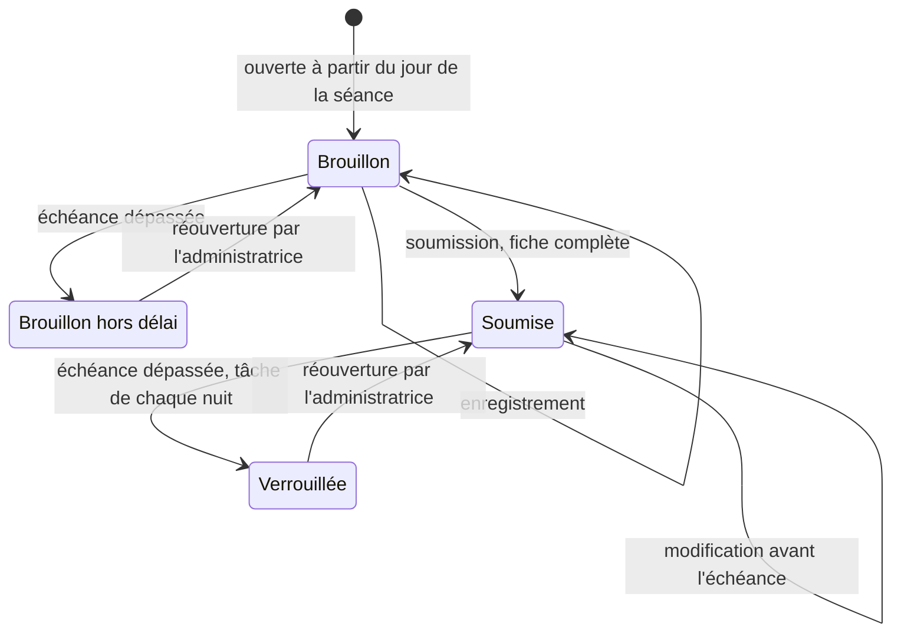
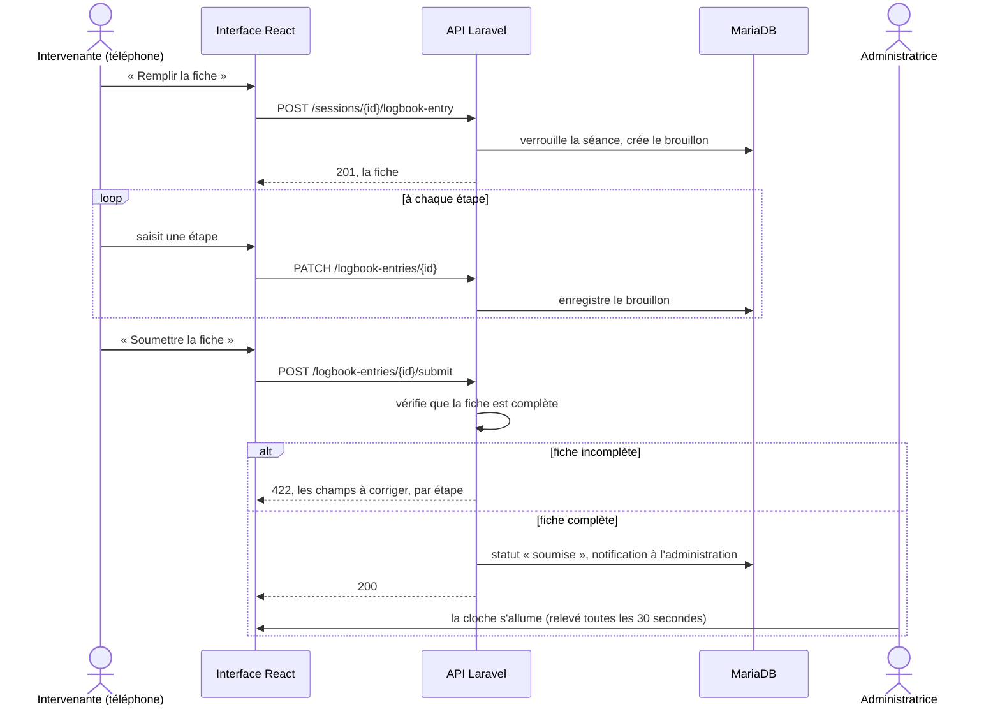
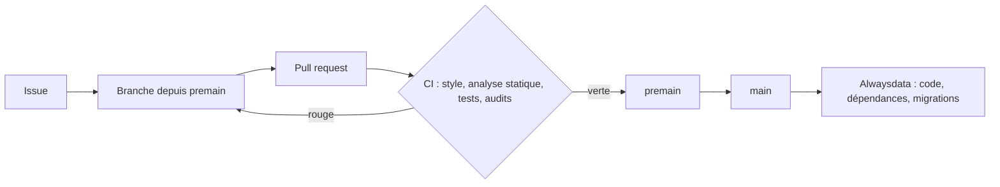

# Conception de KLAP : les diagrammes

Ce document complète le modèle de données ([MCD-carnet-de-bord-KLAP.pdf](MCD-carnet-de-bord-KLAP.pdf))
et la description de l'API ([API.md](API.md)). Les diagrammes sont tirés du code : les classes sont
les modèles de `backend/app/Models`, les états sont ceux que vérifient les tests.

## 1. Qui fait quoi

Une administratrice peut aussi être intervenante : elle remplit alors les fiches des séances dont
elle est la référente. Les droits sont vérifiés par le serveur à chaque requête.

## 2. Les classes

Le nombre de présents est porté par le lien entre la séance et chacun de ses groupes : c'est lui qui
sert à compter les participants (le maximum par groupe, puis la somme des groupes). On ne stocke
aucun élève.

## 3. La vie d'une fiche

L'échéance tombe 10 jours après la séance. Un brouillon hors délai garde son statut : c'est la date
qui le ferme. Une réouverture donne 10 jours à partir du jour où elle est accordée.

Une séance annulée n'a pas de fiche, et une séance qui a une fiche ne s'annule plus ni ne se modifie.
Un projet archivé fige ses séances et ses fiches.

## 4. Remplir et soumettre une fiche

## 5. Du code à la production

